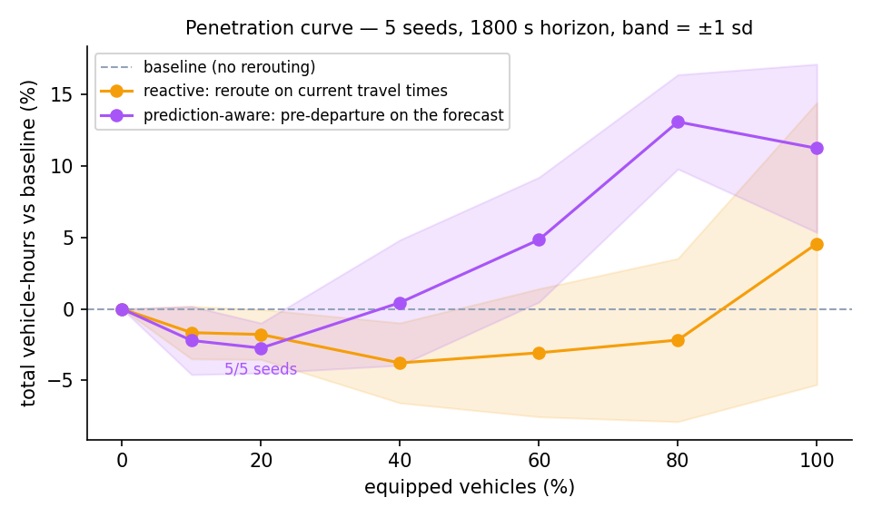
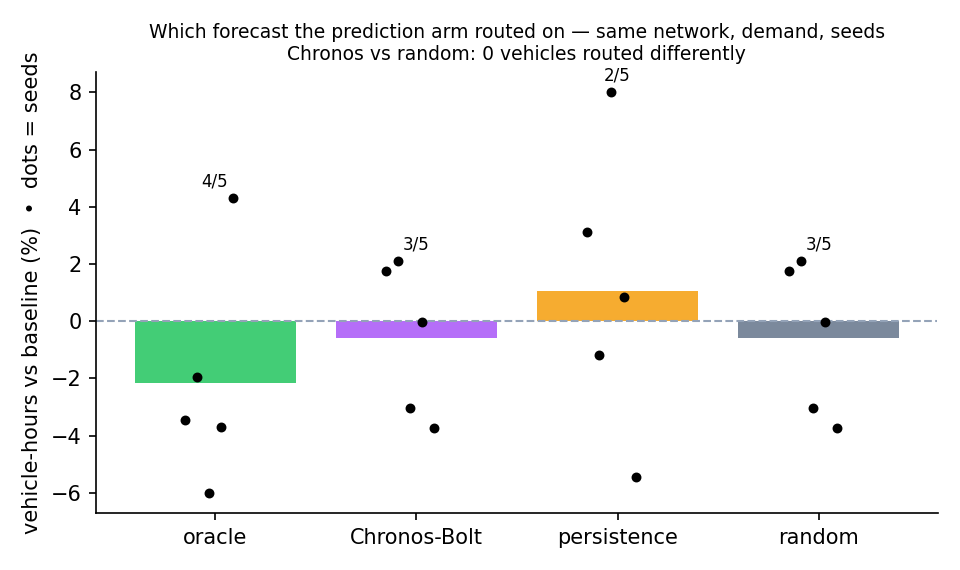
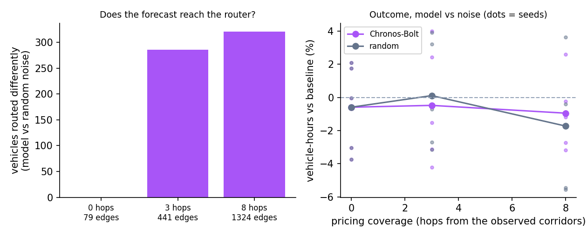
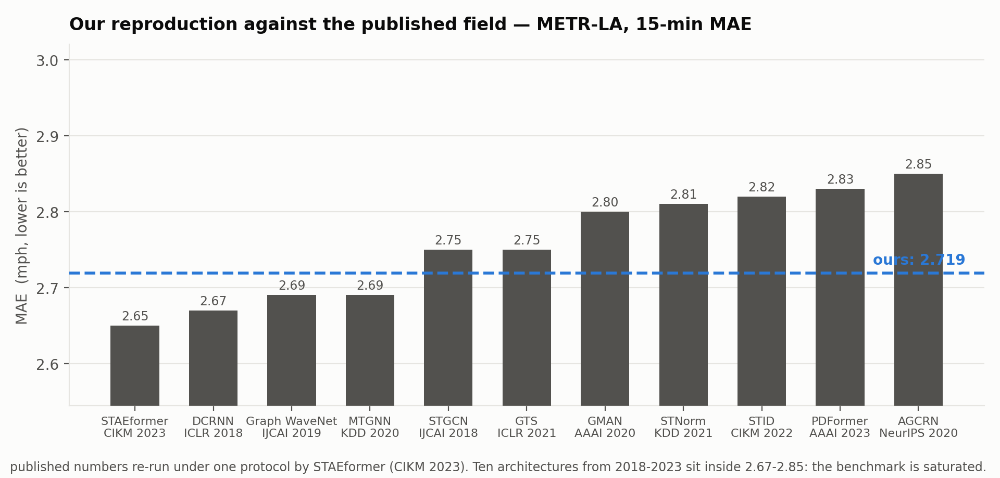
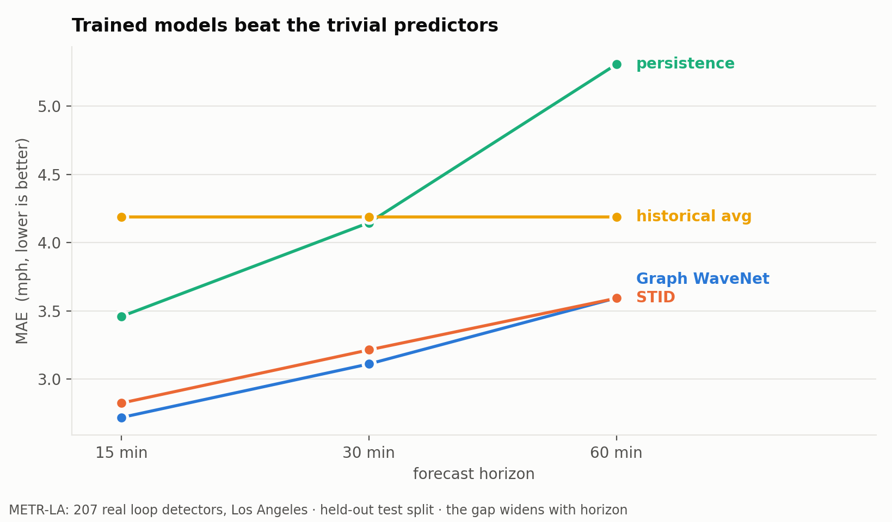
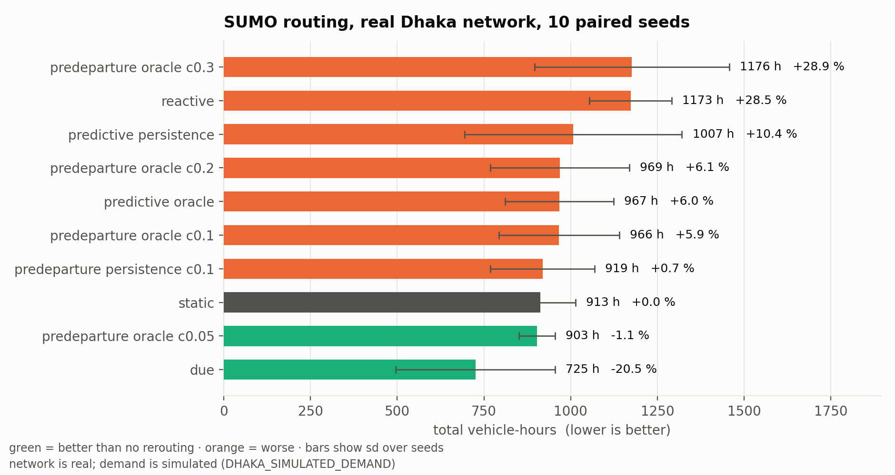

# TrafficTwin

*(formerly DhakaFlow — the system is city-agnostic; Dhaka is its calibrated, live-observed case)*

**Does a better traffic forecast produce better traffic control?** A closed-loop test on a calibrated
SUMO twin of Dhaka fed by real recorded congestion — forecast → future edge costs → route choice →
simulation → measured outcome — with every number regenerable by one command.



**Finding.** Pre-departure rerouting of 10–20 % of vehicles reduces total vehicle-hours in every seed
(−2.7 % at 20 %, 5/5) and *hurts* above 40 % (+13 % at 80 %). The benefit does not come from forecast
accuracy: a pretrained foundation model (Chronos-Bolt) and random noise route **identically** (0 of
2 263 advised vehicles differ), the model has negative skill against persistence on Dhaka's own data
(−23 % at 15 min), and only the oracle forecast moves the outcome (−2.2 %). Between prediction and
control, the first bottleneck is the **coverage of priced edges**: propagating the forecast 8 hops
out from the observed corridors (79 → 1 324 priced edges) makes the router route 321 vehicles
differently for the model than for noise — and the model then does no better than noise, consistent
with its negative skill. Two bottlenecks, both measured: coverage first, then the model.

| | |
|---|---|
| `make backtest` | forecast accuracy on Dhaka's recorded data, rolling origin (15 s) |
| `make chain` | the full chain, three arms, paired seeds, run id (1 min) |
| `make ablation` | oracle / model / persistence / random through the same chain (5 min) |
| `make sweep` | the penetration curve above (10 min) |
| `make coverage` | the same model vs noise at 0 / 3 / 8 hops of pricing coverage (10 min) |
| `make figures` · `make test` · `make app` | figures · 291 tests · the dashboard |




Every figure reads one JSON in `results/`; every JSON names the run directory, seeds, SUMO version
and git commit that produced it. `REPRODUCE.md` maps each claim to its command.


---

## Benchmark validation (public data — supports the pipeline, says nothing about Dhaka)

### Traffic forecasting — METR-LA (207 real loop detectors, Los Angeles)

MAE in mph, held-out test split, official upstream configurations.

**METR-LA** (207 loop detectors, Los Angeles)

| model | 15 min | 30 min | 60 min | published | our difference |
|---|---|---|---|---|---|
| **Graph WaveNet** (IJCAI 2019) | **2.719** | **3.111** | **3.595** | 2.69 / 3.07 / 3.53 | **+1.1 / +1.3 / +1.8 %** |
| **STID** (CIKM 2022) | 2.825 | 3.214 | 3.593 | — | — |
| persistence *(floor)* | 3.460 | 4.147 | 5.308 | — | — |
| historical average *(floor)* | 4.189 | 4.189 | 4.189 | — | — |

**PEMS-BAY** (325 loop detectors, San Francisco Bay Area)

| model | 15 min | 30 min | 60 min | published | our difference |
|---|---|---|---|---|---|
| **Graph WaveNet** | **1.308** | **1.638** | **1.945** | 1.30 / 1.63 / 1.95 | **+0.6 / +0.5 / −0.2 %** |
| **STID** | 1.318 | 1.644 | 1.920 | — | — |
| persistence *(floor)* | 1.590 | 2.170 | 3.040 | — | — |
| historical average *(floor)* | 3.021 | 3.021 | 3.021 | — | — |

Both cities reproduce the published numbers within 2 %; on PEMS-BAY at 60 min the reproduction is
marginally *better* than the paper. All four checkpoints reload from disk and reproduce their own
reported error over 100–150 unseen windows (worst drift 3.6 %).

### Where this sits in the published field



Ten architectures published 2018–2023 sit inside MAE 2.67–2.85 on METR-LA, and four years moved the
best number from 2.69 to 2.65 — a 1.5 % gain. The benchmark is saturated, which the literature says
plainly (STAEformer, CIKM 2023: *"advancements in network architectures have encountered diminishing
performance gains"*; BasicTS, TKDE 2024, exists because inconsistent pipelines make cross-paper
comparison unreliable). Our 2.719 is a correctly reproduced member of that cluster, ahead of
PDFormer (AAAI 2023), STID, AGCRN, GMAN and STNorm.

Two independent checks make these trustworthy:

* **The evaluation protocol was validated before any model ran.** Our historical-average floor
  (4.19 MAE / 7.86 RMSE) reproduces DCRNN's published HA (4.16 / 7.80) to **0.7 %**, so the split,
  masking and metric definitions are the ones the papers used.
* **The checkpoint reproduces its own reported error.** Reloaded from disk and re-run over 150
  held-out windows: 2.716 vs 2.719 reported at 15 min (**−0.1 %**).



### Route optimisation — real Dhaka network, 10 paired seeds

| arm | total vehicle-hours | vs no rerouting |
|---|---|---|
| DUE (offline assignment) | 725 | **−20.5 %** |
| pre-departure, 5 % advised | 903 | **−1.1 %** |
| *static (baseline)* | 913 | — |
| pre-departure, 30 % advised | 1176 | +28.9 % |
| reactive rerouting | 1173 | +28.5 % |

**The finding: advice helps only when few drivers act on it.** Advising 5 % of drivers improves the
network; advising 30 % creates the next jam. Demand is simulated (`DHAKA_SIMULATED_DEMAND`); the
6,527-edge road network is real (OpenStreetMap).



### Networking — Eclipse MOSAIC V2X on the same network

15 runs (5 penetration rates × 3 seeds): delivery ratio 0.96–0.98, latency mean 30 ms / p95 57 ms,
route switches scaling 65 → 713 with penetration. These measured statistics then drive the
federated-learning experiment, which is the point where the ML and networking halves meet:
published federated work (CNFGNN KDD 2021, FedGTP KDD 2024) costs communication *analytically*
— here it is costed with a link that was simulated end to end.

---

## Quick start

```bash
git clone https://github.com/auth889-ai/thesis && cd thesis
python -m venv .venv && source .venv/bin/activate
pip install -r requirements.txt          # SUMO 1.27 must be on PATH for chain/ablation/sweep

make status      # what exists, what is real, what is missing
make backtest    # 15 s — the first real number
make app         # http://127.0.0.1:8000
```

## Data preparation

1. **Public benchmarks** — METR-LA and PEMS-BAY come from the DCRNN release (Li et al., ICLR 2018).
   `pipeline/forecasting/city_datasets.py` fetches them automatically from the project Drive; nothing is vendored.
2. **Check what is present** — `python pipeline/forecasting/city_datasets.py --list`
3. **Load and validate one city** — `python pipeline/forecasting/city_datasets.py --city METR-LA`
   (verifies sensor count against the paper and that missing readings are masked, never scored as 0 mph)
4. **Free the local cache** — `python pipeline/forecasting/city_datasets.py --purge-local`

## Training

Training never runs on a laptop. Two supported paths, both using the pinned upstream harness:

```bash
python pipeline/forecasting/aws_train.py --plan              # cost and configuration first
python pipeline/forecasting/aws_train.py --launch --models GWNet,STID --datasets METR-LA
python pipeline/forecasting/aws_train.py --collect --collect-checkpoints
python pipeline/forecasting/infer_from_checkpoint.py --model GWNet --dataset METR-LA
```

or open `notebooks/Predict_BasicTS_Colab.ipynb` on a Colab GPU.

## Project structure

```
Makefile                      every result is one target; `make` lists them
REPRODUCE.md                  claim -> command -> evidence file
main.py                       `python main.py status`: inventory of data, models, evidence
pipeline/
  forecasting/                STAGE 1  data loaders, live recorder, adapters/ (one interface per model),
                                       live_backtest.py (E1)
  routing/                    STAGE 2  forecast_to_costs.py (forecast -> 79 priced SUMO edges),
                                       integrated_chain.py (E2), forecast_quality_ablation.py (E3),
                                       chain_sweep.py (E4), predictive_routing.py (SUMO arms)
  networking/                 V2X experiments (Eclipse MOSAIC): penetration, latency, loss
  results/make_figures.py     F1-F4 from the JSON evidence
dashboard/backend, frontend   FastAPI + web components; POST /api/experiment/chain/run executes E2
results/                      JSON evidence, per-run SUMO outputs (runs/<run_id>/), figures/
artifacts/live_dhaka/         the recorded REAL_LIVE Dhaka series (derived congestion classes)
paper_labs/02_dhaka_osm/      the frozen Dhaka R1 network build
upstream/                     pinned third-party repos (manifests only)
tests/                        291 tests, run in CI
docs/                         plans, audits, the pre-rebuild reproduce table
legacy/                       retired code, history only
```

## Upstream code

Nothing is re-implemented. Models and the training harness are the authors' own code at pinned
commits, changed only in epoch count and evaluation horizons:

| component | source | pin |
|---|---|---|
| harness | [GestaltCogTeam/BasicTS](https://github.com/GestaltCogTeam/BasicTS) (TKDE 2024) | `4c3e2d37` |
| Graph WaveNet | [nnzhan/Graph-WaveNet](https://github.com/nnzhan/Graph-WaveNet) (IJCAI 2019) | via harness |
| STID | [GestaltCogTeam/STID](https://github.com/GestaltCogTeam/STID) (CIKM 2022) | via harness |
| datasets & protocol | [liyaguang/DCRNN](https://github.com/liyaguang/DCRNN) (ICLR 2018) | — |
| V2X | [eclipse-mosaic/mosaic](https://github.com/eclipse-mosaic/mosaic) 25.2 | release |
| simulation | Eclipse SUMO (Lopez et al., ITSC 2018) | 1.27.1 |

## Honesty labels

Enforced in code and carried in every output file, not only in prose:

* METR-LA / PEMS-BAY results are **REAL** public benchmark data.
* The Dhaka sensor graph is **SIMULATED** (`DHAKA_SIMULATED_SENSOR_GRAPH`) and cannot support a
  real-world claim — a test asserts this.
* The live Dhaka feed stores **derived congestion classes only**; provider content is never
  persisted, and a test asserts that too.
* Where a result does not hold, the file says so — see `results/routing/real_demand.md`, where the
  free-running twin gridlocks and no routing claim is made.

## Citation

```bibtex
@software{dhakaflow2026,
  title  = {DhakaFlow: prediction-aware route optimisation with a V2X-measured communication layer},
  author = {Ferdouse, Jannatul},
  year   = {2026},
  url    = {https://github.com/auth889-ai/thesis}
}
```

See `CITATION.cff` for the upstream papers this work builds on.

## License

MIT — see `LICENSE`. Upstream research code retains its own licenses and is fetched, never vendored.
