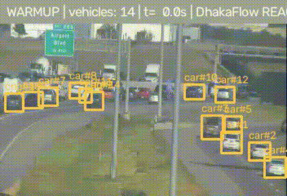
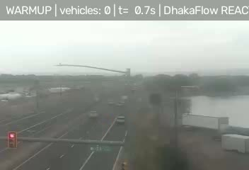
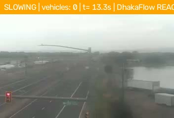
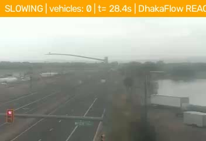
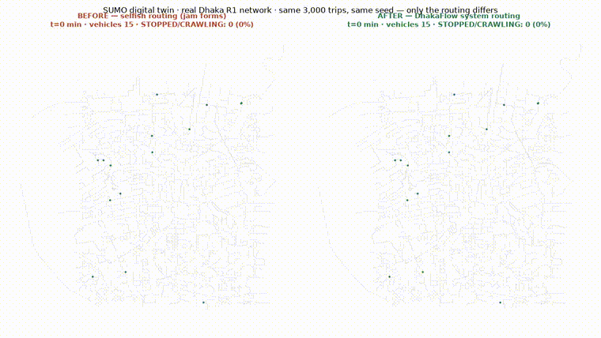
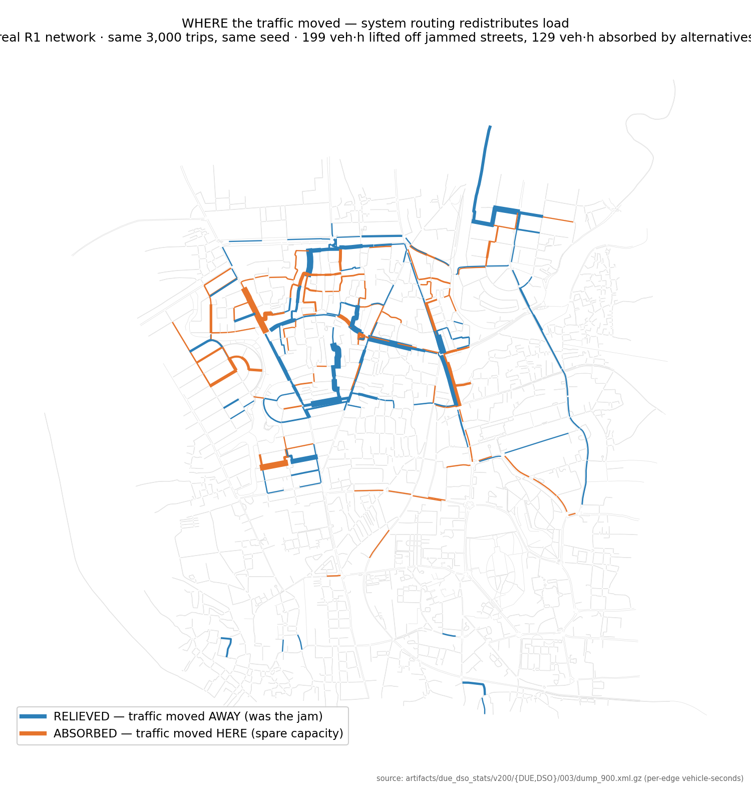

# DhakaFlow Nexus

**Real UAV trajectories → same-street SUMO twin → published cycle-level
calibration (−27% discharge error, authors' code) → held-out validation
(speed MAE 3.0 m/s, 0 teleports) → causal same-state control experiments
under network-honesty guards.**

See `REPRODUCE.md` for the one-command path to every number, and
`PROJECT_MAP.md` for the tour.


> **New here or lost? Read [`PROJECT_MAP.md`](PROJECT_MAP.md) first — 6 main files, 4 commands, everything else is support.**

**AI traffic management for Dhaka:** observe real traffic → predict congestion
before it forms → prevent/react with signal control and routing → prove the
delay reduction inside a SUMO digital twin of the real road network.

---

## Live demo — any video in, traffic intelligence out



*Dense evening rush hour on I-70: ~14 vehicles per frame tracked, 10 of 11
windows flagged **CONGESTED**, `congestion_detected: true` handed to the
routing layer — the moment the system decides to intervene.*

*Real output, unedited: a live US traffic-camera clip run through
`scripts/demo_react.py` with the **Dhaka-fine-tuned RT-DETR r50** winner.
Vehicles detected and tracked, per-window traffic state (banner), timeline and
routing verdict written as JSON. The input slot takes anything — a file, a URL,
an HLS live stream, or a webcam:*

```bash
python scripts/demo_react.py --detector rtdetr \
    --weights artifacts/p1_winner/rtdetr_r50_poribohon_best.pth \
    --source <video | stream-url | webcam-index>
```

| frame | | |
|---|---|---|
|  |  |  |

Demo run stats (from `summary.json`, produced by the run above): 450 frames,
near-real-time on a laptop CPU, detector label `DHAKA_FINETUNED_RTDETR_R50`
(Poribohon-BD 15-class head: rickshaw, CNG, easy-bike, leguna, …).

---

## The proof, moving — same trips, only the routing differs



*The SUMO digital twin on the real Dhaka R1 network: left — selfish routing,
jams form and 1,224 vehicles are still crawling at minute 24; right — DhakaFlow
system routing, the same trips spread over spare capacity, only 930 still on
the road (the rest already arrived). Full statistics: −19.5% mean delay,
p = 1.3×10⁻⁵ (`artifacts/due_dso_stats/v200/result.json`).*



## Results so far (sprint in progress — updated 26 Aug 2026)

| Component | Method (official code, pinned) | Result | Comparison |
|---|---|---|---|
| **Detection** | RT-DETR r50 (CVPR 2024) fine-tuned on Poribohon-BD | **mAP50:95 0.711** · AP50 rickshaw 0.904 / CNG 0.961 / easy-bike 0.965 | beats the dataset paper's best published model (YOLOv8, 0.643) |
| **Forecasting** | Graph WaveNet (IJCAI 2019) via BasicTS harness | **MAE 0.44 m/s @ 15 min** *(simulated domain)* | 3× better than persistence floor (1.39) |
| | STID (CIKM 2022) | MAE 1.09 @ 15 min *(simulated domain)* | beats floor |
| **Routing** | SUMO DUE vs DSO, 10 seeds | **19.5–22.2 % total delay reduction**, p ≤ 1.3×10⁻³ | on the real 6,527-edge Dhaka R1 network |
| **Digital twin** | Eclipse SUMO 1.27.1, real OSM network | 24 h × 3 seeds × 250 sensors generated; 7/7 acceptance checks | evidence-gated PASS |

## Architecture

```
video/stream ─► RT-DETR (Dhaka) ─► tracking ─► traffic state ─┐
                                                              ├─► forecast (GWNet/…) ─► signals (FA-MAPPO*) + routing ─► delay ↓
live refs (Google Routes/Weather, road511) ─► calibration ────┘         proven in the SUMO twin (counterfactual, multi-seed)
```
\* control gate in progress — ablation ladder `MAPPO → +forecast → +pressure → full`.

## Honesty labels (enforced in code, not prose)

* Simulated results carry `DHAKA_SIMULATED_SENSOR_GRAPH` and can never support
  a real-world claim (`ModelEntry.real_world_claim_supported == False`, tested).
* US live data (road511) is `PROVIDER_INTEGRATION_VALIDATION` + domain-shift
  measurement — never Dhaka validation.
* Every upstream repo is pinned by commit (`upstream/UPSTREAM_PINS.yaml`);
  official code is never modified — adapters translate formats only.

## Where things live

* `docs/STATUS_BOARD.md` — live single source of truth
* `docs/SPRINT_140H.md` — the hour-by-hour execution plan
* `docs/INTEGRATED_BUILD_PLAN.md` — full research design, gates, policies
* `paper_labs/` — frozen foundations (UTD19 science, SUMO platform, Dhaka network)
* `research/`, `dhakaflow/` — components and platform contracts
