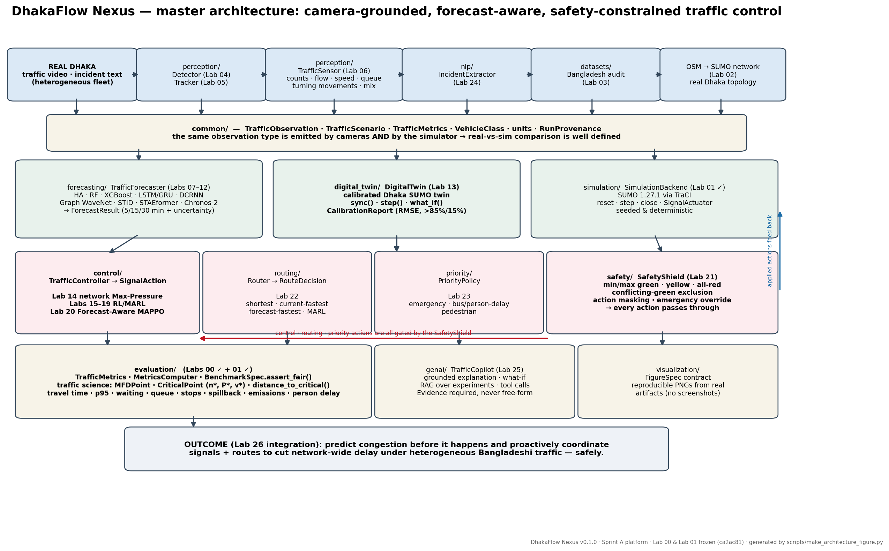
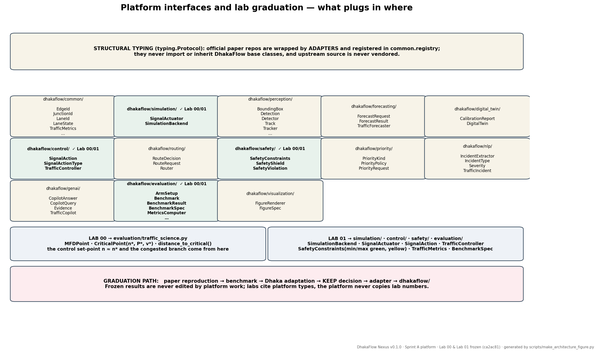

# DhakaFlow Nexus — platform architecture (Sprint A)

**Goal of the system:** predict congestion before it happens and proactively
coordinate traffic signals and routes to reduce network-wide delay under
heterogeneous Bangladeshi urban traffic — safely.

`paper_labs/` are scientific capsules (reproduce, benchmark, decide).
`dhakaflow/` is the permanent product. This document defines the boundary.




## Layout

```
dhakaflow/
  common/         TrafficScenario · TrafficObservation · TrafficMetrics · VehicleClass
                  units (canonical) · RunProvenance · component registry
  simulation/     SimulationBackend · SignalActuator                 ← Lab 01 ✓
  perception/     Detection · Track · Detector · Tracker · TrafficSensor   (Labs 04–06)
  forecasting/    ForecastRequest · ForecastResult · TrafficForecaster     (Labs 07–12)
  digital_twin/   DigitalTwin · CalibrationReport                          (Lab 13)
  control/        SignalAction · SignalActionType · TrafficController ← Lab 01 ✓ (Labs 14–20)
  routing/        RouteRequest · RouteDecision · Router                    (Lab 22)
  safety/         SafetyConstraints · SafetyShield · SafetyViolation ← Lab 01 ✓ (Lab 21)
  priority/       PriorityRequest · PriorityPolicy                         (Lab 23)
  nlp/            TrafficIncident · IncidentExtractor                      (Lab 24)
  genai/          CopilotQuery · CopilotAnswer · Evidence · TrafficCopilot (Lab 25)
  evaluation/     TrafficMetrics computation · BenchmarkSpec ← Lab 01 ✓
                  traffic_science: MFDPoint · CriticalPoint ← Lab 00 ✓
  visualization/  FigureSpec · FigureRenderer
```

Supporting trees: `paper_labs/` (capsules), `benchmarks/`, `third_party/` +
per-lab `upstream/` (pinned, never vendored), `datasets/`, `scenarios/`,
`services/`, `deployment/`, `infra/`, `tests/`, `docs/`.

## Five design decisions (and why)

**1. Structural typing, not inheritance.** Every contract is a
`typing.Protocol`. An official repo (RT-DETR, ByteTrack, PressLight, CoLight,
MAPPO, DCRNN, Chronos-2) is wrapped by a thin adapter that simply *has* the
right methods; it never imports DhakaFlow, so upstream stays clean and
un-vendored. `tests/platform/test_interfaces.py` proves three foreign classes
satisfy the protocols while inheriting only from `object`.

**2. One observation type for cameras and simulator.** `TrafficSensor.observe()`
(Lab 06) and `SimulationBackend.step()` (Lab 01) both return
`TrafficObservation`. This is what makes real-vs-simulated calibration (Lab 13)
and sim2real transfer (Lab 21) *type-level* guarantees rather than glue code.

**3. Safety is a layer, not a habit.** In Lab 01 each controller policed its own
min/max-green. An RL policy cannot be trusted to do that, so `SafetyShield` sits
between controller and actuator: it returns a safe replacement action and logs a
`SafetyViolation` rather than raising — violations become a first-class metric
instead of a crash.

**4. Missing values are `None`, never `0`.** `TrafficMetrics` fields default to
`None`; `speed_from_flow_density` raises at zero density. Lab 00 showed how a
silent unit or zero assumption corrupts an aggregate (occupancy arriving as
0–100 percent).

**5. Fairness is executable.** `BenchmarkSpec.assert_fair()` refuses to compare
arms that differ in scenario, seeds, warmup, duration or safety constraints.
"Same conditions" is checked by code, not promised in prose.

## Component registry

```python
from dhakaflow.common.registry import register, build

@register("controller", "colight_official")
def _make(**kw):
    from third_party.colight_adapter import CoLightAdapter   # local import only
    return CoLightAdapter(**kw)

ctrl = build("controller", "colight_official", min_green=10)
```

Registering the same `(category, name)` twice raises — the platform refuses to
hold two competing sources of truth for one component. Heavy dependencies are
imported inside factories, so a missing research dependency can never break
`import dhakaflow`.

## Result-type separation

`RunProvenance.result_kind` is one of `PUBLISHED_RESULT`, `REPRODUCED_RESULT`,
`DHAKA_RESULT`, `DHAKAFLOW_FOUNDATION_EXPERIMENT`. `require_complete()` refuses
to emit a record lacking git SHA or seeds. Reports must never mix the kinds.

## What Sprint A deliberately does NOT contain

No algorithms. No model weights. No SUMO/torch imports at platform import time.
No Lab 02+ work. The platform is contracts and shared types only; the first real
implementations arrive as adapters when their labs pass.
