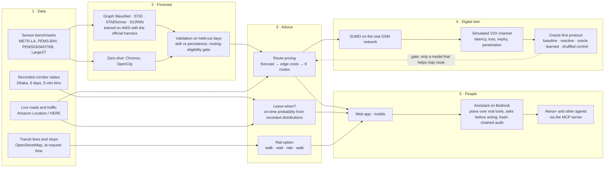

# TrafficTwin — the full workflow and what is ours

One sentence: **TrafficTwin forecasts road traffic with a learned model, turns the forecast into route
and departure advice, tests that advice in a traffic simulation with a simulated V2X channel, and
gives it to people through an app and an assistant — and it measures, rather than assumes, whether
the forecast helps.**

## The pipeline, end to end

## What happens when a person asks "when should I leave?"

1. The place names are resolved (known places, or OpenStreetMap's geocoder inside the city).
2. Amazon Location returns up to three real routes with geometry and free-flow times, and live traffic where HERE covers the city.
3. Where there is no live coverage (Dhaka today), the recorded time-of-day distribution of each corridor the route runs along prices the route now and at every candidate departure.
4. For each departure the on-time probability is the share of that distribution that meets the deadline; the latest departure with at least 80 % is recommended.
5. OpenStreetMap is read for rail lines within walking reach; the rail option is set beside the road routes with each leg's basis stated.
6. The answer carries its provenance in one sentence: which provider, whether traffic was live, which model, which numbers are estimates.
7. If the person asked the assistant instead, a Bedrock model planned these same calls; anything irreversible paused for approval; every step is in the audit chain.

## What is ours, and what is reused

| Ours (new in this project) | Reused, unchanged, cited |
|---|---|
| **The oracle-first evaluation protocol**: perfect information must beat reactive routing before any learned model is tested, with a shuffled forecast as the negative control and paired confidence intervals over unseen days. Result: perfect information helps (−1.83 %), the learned forecast does not yet beat no advice — stated, not rounded up. | Graph WaveNet, DCRNN, STID, STAEformer (official code through the BasicTS harness) |
| **The closed-loop V2X digital twin**: forecast → edge costs → optimizer → simulated channel (latency, loss, expiry, 30 % penetration) → SUMO reroute, with saved-state forks so every arm starts identical, and hash-chained provenance per round. | SUMO, Eclipse MOSAIC, ETSI ITS-G5 |
| **The stress calibration rule** (travel-time index ≥ 1.3, standing jams, ≤ 1 % lost vehicles) that decides whether a scenario is congested enough for advice to matter. | METR-LA, PEMS, LargeST datasets |
| **The departure-time recommender** with an empirical on-time probability from recorded time-of-day corridor distributions, and a routing layer that says when a city has no live coverage instead of pretending. | Amazon Location / HERE, OpenStreetMap, Chronos, OpenCity |
| **The routing-eligibility gate**: a model may drive advice only after passing held-out validation on that city's own data. | Bedrock models, the MCP specification |
| **The assistant's permission engine and audit chain**: typed risk classes, refusal of invented sensitive arguments, an append-only log any reviewer can verify, exposed to Alexa+ through MCP. | |

## What to say when asked "where is your model?"

We trained Graph WaveNet and STID ourselves on AWS GPUs with the official configurations, validated
them on held-out days (the lab's Models page shows the numbers and the checkpoint hashes), and then
did something most papers do not: we measured whether the forecast changes outcomes in a simulation
of a congested corridor, against a perfect-information ceiling. The forecast is accurate (it beats
"no change" by a clear margin) and the pipeline is real, and the honest finding is that on this
corridor the ceiling itself is only about 2 %, so the remaining gain must come from covering more
roads, not from a better model. That negative result is a contribution.
